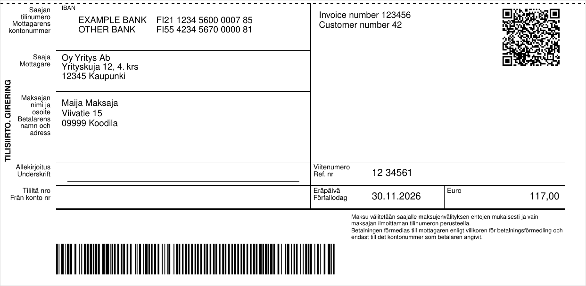

# fi-invoice-payment-slip: laskun maksuosa (tilisiirtolomake) PDFKitille

[](https://www.npmjs.com/package/@niemenjoki/fi-invoice-payment-slip)
[](https://www.npmjs.com/package/@niemenjoki/fi-invoice-payment-slip)
[](https://github.com/niemenjoki/fi-invoice-payment-slip/actions/workflows/test.yml)
[](LICENSE)
[](package.json)

[English](https://github.com/niemenjoki/fi-invoice-payment-slip/blob/main/README.md) | Suomi

Lisää suomalainen tilisiirtolomake (*tilisiirto / girering*) [PDFKitillä](https://pdfkit.org/) tehdyn PDF-laskun
alareunaan: viitenumero, pankkiviivakoodi ja pankkisovellusten lukema QR-koodi.



Mitä paketti tekee:

- suomalaiset viitenumerot (tarkiste 7-3-1) ja RF-viitteet (ISO 11649)
- pankkiviivakoodi (*virtuaaliviivakoodi*), versiot 4 ja 5, piirrettynä Code 128 C -koodina
- QR-koodi, jonka suomalaiset pankkisovellukset lukevat (Finanssiala ry:n ohje 2015, pohjana EPC069-12)
- lomakkeen tekstit suomeksi ja ruotsiksi (virallinen kaksikielinen lomake) tai englanniksi

Koodit on testattu Finanssiala ry:n viivakoodi- ja QR-oppaiden esimerkkejä vasten (ks. [Testit](#testit)).

## Asennus

```sh
npm install @niemenjoki/fi-invoice-payment-slip pdfkit
```

`pdfkit` on vertaisriippuvuus (peer dependency), joten lomake piirretään samalla PDFKitillä kuin muukin lasku.

Paketti on pelkkä ES-moduuli. CommonJS-projektissa (`require`) käytä `await import('@niemenjoki/fi-invoice-payment-slip')` tai Node.js:n versiota 22.12 tai uudempaa.

## Maksuosa laskuun

```js
import fs from 'node:fs';
import PDFDocument from 'pdfkit';
import { drawPaymentSlip, createFinnishReference } from '@niemenjoki/fi-invoice-payment-slip';

const doc = new PDFDocument({ size: 'A4' });
doc.pipe(fs.createWriteStream('lasku.pdf'));
// ... laskun sisältö sivun yläosaan ...

drawPaymentSlip(doc, {
  accounts: [{ bank: 'OP', iban: 'FI21 1234 5600 0007 85' }],
  bic: 'OKOYFIHH',
  recipient: { name: 'Esimerkki Oy', address: ['Esimerkkikatu 1', '00100 Helsinki'] },
  payer: { name: 'Maija Maksaja', address: ['Viivatie 15', '09999 Koodila'] },
  amountCents: 11700,
  reference: createFinnishReference('123456'), // '1234561'
  dueDate: '2026-11-30',
  info: ['Lasku 123456'],
});
doc.end(); // kirjoittaa tiedoston lasku.pdf
```

Lomake on 210 × 101,6 mm, ja se piirretään nykyisen sivun alareunaan, ellei sijaintia anneta pisteinä (`{ x, y }`).
Jätä tämä alue laskussa tyhjäksi.

Pelkän lomakkeen PDF:nä saa näin: `const buffer = await createPaymentSlipPdf(data)`.

## Tiedot

| Kenttä | Selitys |
|---|---|
| `accounts` | 1-4 tiliä muodossa `{ iban, bank? }`. Ensimmäinen menee viivakoodiin ja QR-koodiin. Yhdelle tilille voi käyttää myös kenttiä `iban` ja `bank`. |
| `bic` | Valinnainen. BIC-koodin kanssa QR-koodi on versiota 001 kuten Finanssialan ohjeessa, ilman sitä EPC-versiota 002. |
| `recipient` | `{ name, address? }`. Merkkijonoja tai rivien taulukoita. |
| `payer` | Valinnainen `{ name?, address? }`. |
| `amountCents` | Summa sentteinä kokonaislukuna. `null` = maksaja päättää summan. |
| `reference` | Suomalainen viite tai RF-viite, välilyönneillä tai ilman. Tarkiste tarkistetaan. |
| `message` | Käytetään vain, jos viitettä ei ole. Tulostetaan tietokenttään ja lisätään QR-koodiin. |
| `dueDate` | `YYYY-MM-DD` tai `Date` (UTC-päivä). Valinnainen. |
| `info` | Tietokentän teksti, esim. laskun- ja asiakasnumero. |
| `language` | `fi-sv` (oletus) tai `en`. |
| `barcode`, `qr` | `false` jättää koodin pois. |

Mitä tulostetaan oppaiden mukaisesti:

- Viite paperimuodossa: suomalainen viite viiden merkin ryhminä oikealta (`12 34561`), RF-viite neljän merkin
  ryhminä (`RF07 6633 2132 8510`).
- Viivakoodi on versio 4 suomalaisella viitteellä ja versio 5 RF-viitteellä. Se jätetään pois, jos viitettä ei ole,
  tilinumero ei ole suomalainen tai RF-viitteessä on kirjaimia. Yli 999 999,99 euron summa ja maksajan valitsema
  summa merkitään nollina, kuten opas sallii.
- QR-koodin moduuli on 0,5 mm, ja koodi on oikeassa yläkulmassa. Eräpäivä on viimeisessä kentässä muodossa
  `ReqdExctnDt/YYYY-MM-DD`. Sisällön enimmäispituus on 331 tavua.

## Koodit ilman PDF:ää

```js
import {
  createFinnishReference, createRfReference, formatReference,
  createVirtualBarcode, createQrPayload,
} from '@niemenjoki/fi-invoice-payment-slip';

createRfReference('1234561');            // 'RF..1234561' (ISO 11649 -tarkiste)
formatReference('00000000000001234561'); // '12 34561'
createVirtualBarcode({ iban: 'FI21 1234 5600 0007 85', amountCents: 11700, reference: '1234561', dueDate: '2026-11-30' });
// '421123456000007850001170000000000000000001234561261130'
```

Kaikki virheet ovat `PaymentSlipError`-olioita, joiden `code` kertoo syyn, esim. `invalid_reference`,
`invalid_iban` tai `qr_too_long`.

## Ennen kuin lähetät oikeita laskuja

Lue testilomake niiden pankkien sovelluksilla, joita asiakkaasi käyttävät, ja tarkista, että viivakoodi ja QR-koodi
täyttävät saman tilinumeron, summan, viitteen ja eräpäivän kuin lomakkeen teksti. Oppaiden mukaan laskuttaja vastaa
lomakkeen tiedoista. `npm run example` tekee kolme testi-PDF:ää kansioon `examples/out/`.

Tähän mennessä testattu: viivakoodi OP-mobiililla (marraskuu 2026), joka täytti tilinumeron, summan, viitteen ja
eräpäivän oikein. QR-koodi vastaa oppaan esimerkkiä tavu tavulta, mutta sitä ei ole vielä kokeiltu
pankkisovelluksella. Kaikki sovellukset eivät lue sitä: OP-mobiili lukee vain viivakoodin.

Asettelu noudattaa Finanssiala ry:n tilisiirto-ohjeen (2014) mittoja. Mikään pankki ei ole sertifioinut lomaketta.

## Testit

```sh
npm test
```

- Viivakoodioppaan (Bank Bar Code Guide) v5.3 kaikki 18 testilaskua (versiot 4 ja 5) Code 128 -tarkistemerkkeineen. Opas tulostaa
  version 5 laskulle 3 tarkistemerkin 59, mutta sen oma Modulus 103 -algoritmi antaa tulostetuille tiedoille 34.
  Testi käyttää arvoa 34 ja kertoo syyn.
- QR-ohjeen esimerkki 1 tavu tavulta.
- Viite-esimerkit tilisiirto-ohjeesta ja RF-viiteoppaasta.

Lähteet (Finanssiala ry, www.finanssiala.fi, testeissä käytetyt englanninkieliset versiot): Bank Bar Code Guide
v5.3 (2012, korjattu 2019), Guidelines for the QR code in the Credit Transfer Forms (2015), Credit Transfer
Guidelines (2014), Structure of the RF Creditor Reference (2023), Forming a Finnish reference number.

## Muutokset

Ks. [CHANGELOG.md](CHANGELOG.md) (englanniksi).

## Lisenssi

MIT
