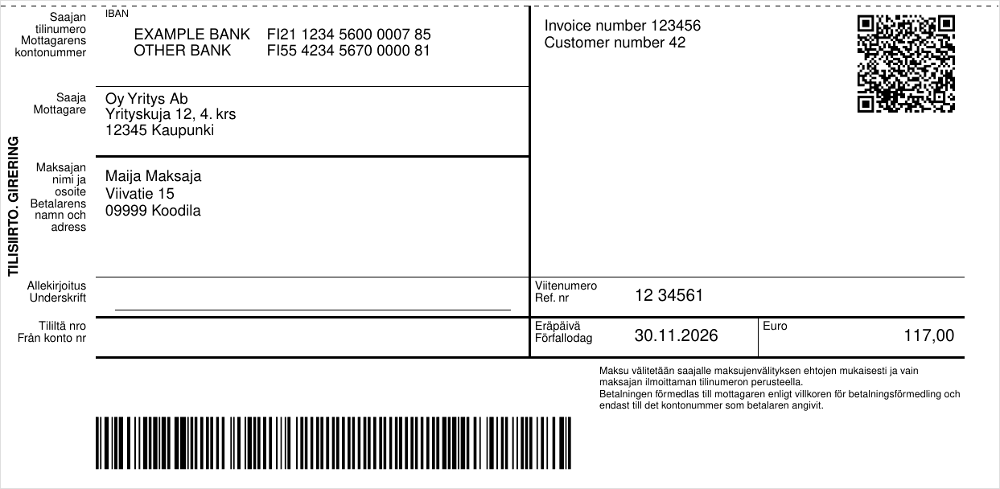

# fi-invoice-payment-slip: Finnish invoice payment slip for PDFKit

[](https://www.npmjs.com/package/@niemenjoki/fi-invoice-payment-slip)
[](https://www.npmjs.com/package/@niemenjoki/fi-invoice-payment-slip)
[](https://github.com/niemenjoki/fi-invoice-payment-slip/actions/workflows/test.yml)
[](LICENSE)
[](package.json)

English | [Suomi](https://github.com/niemenjoki/fi-invoice-payment-slip/blob/main/README.fi.md)

Add the Finnish credit transfer form (*tilisiirto / girering*) to the bottom of an invoice PDF made with
[PDFKit](https://pdfkit.org/): reference number, bank bar code and the QR code that mobile bank apps read.



What it does:

- Finnish reference numbers (7-3-1 check digit) and RF creditor references (ISO 11649)
- bank bar code (*pankkiviivakoodi*, *virtuaaliviivakoodi*), versions 4 and 5, drawn as Code 128 C
- QR code that Finnish mobile bank apps read (Finance Finland 2015 guideline, based on EPC069-12)
- form labels in Finnish and Swedish (the official bilingual form) or English

The codes are tested against the examples in Finance Finland's bar code and QR code guides (see [Tests](#tests)).

Used in production: the payment slips of the invoices of [lieromaa.fi](https://www.lieromaa.fi/?utm_source=github&utm_medium=readme&utm_campaign=fi-invoice-payment-slip), my small online shop, are
drawn with this package.

**Suomeksi:** laskun maksuosa eli tilisiirtolomake PDF-laskuun Node.js:llä. Paketti laskee viitenumeron
(myös RF-viitteen), tekee virtuaaliviivakoodin ja pankkiviivakoodin (versiot 4 ja 5) sekä pankkisovellusten
QR-koodin ja piirtää lomakkeen Finanssiala ry:n mittojen mukaan. Lomakkeen tekstit ovat suomeksi ja ruotsiksi tai
englanniksi. [Ohje suomeksi](https://github.com/niemenjoki/fi-invoice-payment-slip/blob/main/README.fi.md).

## Install

```sh
npm install @niemenjoki/fi-invoice-payment-slip pdfkit
```

`pdfkit` is a peer dependency, so the slip is drawn with the same PDFKit you use for the rest of the invoice.

The package is an ES module only. In a CommonJS project (`require`), use `await import('@niemenjoki/fi-invoice-payment-slip')` or Node.js 22.12 or newer.

## Add the slip to your invoice

```js
import fs from 'node:fs';
import PDFDocument from 'pdfkit';
import { drawPaymentSlip, createFinnishReference } from '@niemenjoki/fi-invoice-payment-slip';

const doc = new PDFDocument({ size: 'A4' });
doc.pipe(fs.createWriteStream('invoice.pdf'));
// ... your invoice content on the upper part of the page ...

drawPaymentSlip(doc, {
  accounts: [{ bank: 'OP', iban: 'FI21 1234 5600 0007 85' }],
  bic: 'OKOYFIHH',
  recipient: { name: 'Example Oy', address: ['Esimerkkikatu 1', '00100 Helsinki'] },
  payer: { name: 'Maija Maksaja', address: ['Viivatie 15', '09999 Koodila'] },
  amountCents: 11700,
  reference: createFinnishReference('123456'), // '1234561'
  dueDate: '2026-11-30',
  info: ['Invoice 123456'],
});
doc.end(); // writes invoice.pdf
```

The form is 210 × 101.6 mm and goes to the bottom of the current page unless you pass `{ x, y }` in points.
Leave that area empty on the invoice.

To get a PDF with only the slip: `const buffer = await createPaymentSlipPdf(data)`.

## Data

| Field | Notes |
|---|---|
| `accounts` | 1-4 `{ iban, bank? }`. The first one goes into the bar code and the QR code. Or use `iban` and `bank`. |
| `bic` | Optional. With a BIC the QR code uses version 001, as in the Finance Finland guide. Without it, EPC version 002. |
| `recipient` | `{ name, address? }`. Strings or arrays of lines. |
| `payer` | Optional `{ name?, address? }`. |
| `amountCents` | Integer cents. `null` lets the payer choose the amount. |
| `reference` | Finnish or RF reference, with or without spaces. Validated. |
| `message` | Used only without a reference. Printed in the information section and put in the QR code. |
| `dueDate` | `YYYY-MM-DD` or a `Date` (UTC date). Optional. |
| `info` | Text for the information section, e.g. invoice and customer number. |
| `language` | `fi-sv` (default) or `en`. |
| `barcode`, `qr` | Set to `false` to leave a code out. |

What is printed, following the guides:

- References in paper format: Finnish in groups of five from the right (`12 34561`), RF in groups of four (`RF07 6633 2132 8510`).
- The bar code is version 4 for a Finnish reference and version 5 for an RF reference. It is left out without a
  reference, for a non-Finnish IBAN and for RF references that contain letters. Amounts over 999 999,99 € and a
  payer-chosen amount are encoded as zeros, which the guide allows.
- The QR code has 0.5 mm modules and sits in the top right corner. The due date goes in the last field as
  `ReqdExctnDt/YYYY-MM-DD`. The payload is limited to 331 bytes.

## Codes without a PDF

```js
import {
  createFinnishReference, createRfReference, formatReference,
  createVirtualBarcode, createQrPayload,
} from '@niemenjoki/fi-invoice-payment-slip';

createRfReference('1234561');            // 'RF..1234561' (ISO 11649 check digits)
formatReference('00000000000001234561'); // '12 34561'
createVirtualBarcode({ iban: 'FI21 1234 5600 0007 85', amountCents: 11700, reference: '1234561', dueDate: '2026-11-30' });
// '421123456000007850001170000000000000000001234561261130'
```

Every error is a `PaymentSlipError` with a `code` such as `invalid_reference`, `invalid_iban` or `qr_too_long`.

## Before you send real invoices

Scan a test slip with the mobile apps of the banks your customers use, and check that the bar code and QR code
fill in the same account, amount, reference and due date as the printed text. The guides make the invoicer
responsible for the data on the form. `npm run example` writes three test PDFs to `examples/out/`.

Tested so far: the bar code with OP Mobile (November 2026), which filled in the account, amount, reference and
due date correctly. The QR code matches the guideline's example byte for byte but has not yet been tried with a
bank app. Not every app reads it: OP Mobile reads only the bar code.

The layout follows the dimensions in Finance Finland's Credit Transfer Guidelines (2014). It has not been
certified by any bank.

## Tests

```sh
npm test
```

- All 18 test invoices of the Bank Bar Code Guide v5.3 (versions 4 and 5), including the Code 128 check characters.
  The guide prints check character 59 for version 5 invoice 3, but its own Modulus 103 algorithm gives 34 for the
  printed data. The test uses 34 and explains why.
- Example 1 of the QR code guideline, byte for byte.
- Reference examples from the Credit Transfer Guidelines and the RF reference guide.

Sources (Finance Finland, www.finanssiala.fi): Bank Bar Code Guide v5.3 (2012, corrected 2019), Guidelines for the
QR code in the Credit Transfer Forms (2015), Credit Transfer Guidelines (2014), Structure of the RF Creditor
Reference (2023), Forming a Finnish reference number.

## Changelog

See [CHANGELOG.md](CHANGELOG.md).

## License

MIT
